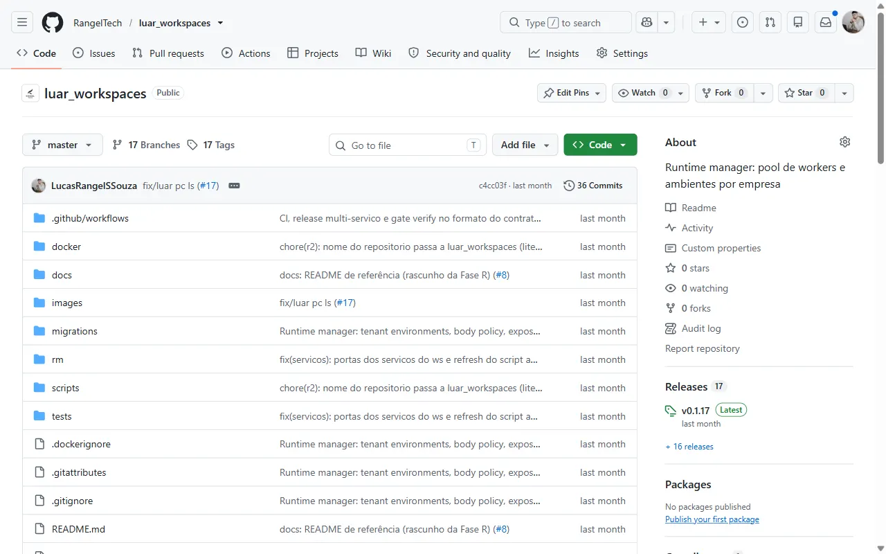

<!-- readme-padrao -->
# LUAR: ambientes por empresa

> Gerenciador de ambientes por empresa do LUAR (runtime-manager, borda, workspace e executor).



## O que é
Gerenciador de ambientes por empresa do LUAR (runtime-manager, borda, workspace e executor).

Estado: **no ar (LUAR em preparo)**.

## Onde está no ar
- Sem endereço público próprio.

## Onde faz o deploy
Este repositório **só publica** o artefato (release com imagem e manifesto); **quem implanta é o `vps_rt_infra`**.

- Serviço `runtime-manager`: `gh workflow run deploy.yml --repo RangelTech/vps_rt_infra -f service=runtime-manager` (só validar: `-f dry_run=true`; voltar versão: `-f version=<tag-antiga>`)
- Serviço `edge`: `gh workflow run deploy.yml --repo RangelTech/vps_rt_infra -f service=edge` (só validar: `-f dry_run=true`; voltar versão: `-f version=<tag-antiga>`)
- Serviço `workspace`: `gh workflow run deploy.yml --repo RangelTech/vps_rt_infra -f service=workspace` (só validar: `-f dry_run=true`; voltar versão: `-f version=<tag-antiga>`)
- Serviço `executor`: `gh workflow run deploy.yml --repo RangelTech/vps_rt_infra -f service=executor` (só validar: `-f dry_run=true`; voltar versão: `-f version=<tag-antiga>`)

Os `.env` desses serviços são gerados do Infisical no momento do deploy (spec 57, seção 0A).

## Como funciona por dentro
Resumo acima; os detalhes estão nas notas técnicas (README anterior) abaixo e na spec 57.

## Segredos
Nenhum valor de segredo fica neste repositório. Os segredos dos serviços ficam no Infisical (mapa em `vps_rt_infra/scripts/infisical/mapa_envs.json`) e chegam à VPS gerados no deploy.

## Rodar e testar localmente
Ver as notas técnicas abaixo (cada repositório tem o seu jeito); os testes de QA em produção são por cliques reais, com evidência em `new_ragente/qa/evidencias`.

## Links
- Repositório: https://github.com/RangelTech/luar_workspaces
- Painel único: https://painel.rangeltech.net
- Spec de organização geral: `new_ragente/specs/57_ORGANIZACAO_GERAL_PRODUTOS_E_PAINEL.md`

## Notas técnicas (README anterior)

# luar_workspaces

O ambiente de cada empresa: workspace com terminal e arquivos, executor efêmero para as ferramentas e a borda que publica os apps. Um serviço FastAPI cria e controla tudo pelo docker-socket-proxy, com cotas e firewall por empresa.

> Nome anterior: `runtime-manager`.

## Onde ele se encaixa

```
                    Cliente (navegador e canais)
                                |
                        Traefik (VPS)
                                |
 luar_chatwoot --contexto assinado--> luar_engine --runs--> luar_harness
 (telas, inbox, Kanban,               (motor de IA:         (fila, broker,
  bridge, gateway de canais)           templates, skills,    workers Hermes)
                                       credenciais, uso)            |
                                            |                luar_workspaces
                                       luar_ai_gateway       (ambiente de cada
                                       (LLM multi-tenant)     empresa)

 vps_rt_infra: compose, releases por digest, deploy e backup (só ela implanta)
 airflow:      orquestração da empresa, inclui o backup noturno da VPS
 luar_docs:    specs, evidências e ADRs
```

## Árvore de pastas

```
rm/                   serviço FastAPI (executor, cota, firewall nft, domínios, uso, traefik)
images/rt-workspace/  imagem do workspace (Debian, s6-overlay, sshd)
images/rt-executor/   executor efêmero, sem rede
images/rt-edge/       Traefik de borda para os apps
tests/unit/           testes offline (família W)
tests/integration/    testes com Docker (fora do gate)
scripts/              verify.sh e release_build.py
```

## Como rodar e testar

```bash
bash scripts/verify.sh                 # ruff + testes unitários
pytest tests/integration -m docker     # precisa de Docker
```

## Como implantar

Uma tag `v*` publica 4 artefatos (`runtime-manager`, `workspace`, `executor`, `edge`), cada um com seu manifesto. O deploy é só pelo `vps_rt_infra`.

## Isolamento e segurança

- O nome da empresa é validado (`^[a-z][a-z0-9]{3,19}$`).
- O executor não tem rede; o workspace sai para a internet só pelo que o firewall da empresa permite.
- O serviço nunca fala com o Docker direto, só pelo socket-proxy.

## Contratos e APIs

API interna (FastAPI, só rede privada): `GET /health`, `GET /metrics`, `GET /v1/fleet` e `POST /v1/fleet:freeze`; `POST /v1/executor/runs`; pool de workers em `/v1/pool/*`; ciclo da empresa em `/v1/tenants/{t}` (criar, `runtime:{ação}`, `workspace:{ação}`, `backup`, `restore`, `exposures`, `domains`, `events`). Definidas em `rm/api.py`. Variáveis: `RM_LOG_LEVEL` e as de `rm/` (só nomes; valores ficam no Infisical).

## Runbooks e decisões

- [`docs/runbooks/kill-switch.md`](docs/runbooks/kill-switch.md): congelar a frota ou uma empresa.
- [`docs/adr/0001-executor-sem-rede.md`](docs/adr/0001-executor-sem-rede.md): por que o executor não tem rede.

## Como contribuir

Uma branch por tarefa, Conventional Commits em português, `verify.sh` verde.
